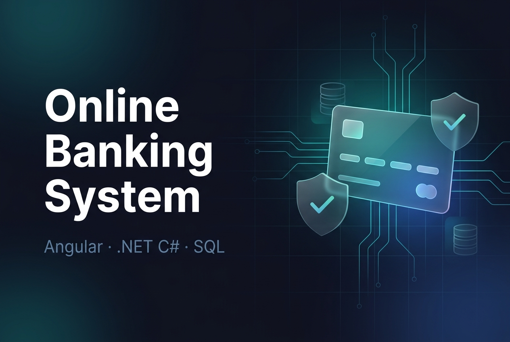

# Online Banking System

<picture>
  <source media="(prefers-color-scheme: dark)" srcset="https://img.shields.io/badge/Angular-1a1b27?style=for-the-badge&logo=angular&logoColor=DD0031"/>
  
</picture>
<picture>
  <source media="(prefers-color-scheme: dark)" srcset="https://img.shields.io/badge/.NET%20C%23-1a1b27?style=for-the-badge&logo=dotnet&logoColor=512BD4"/>
  
</picture>
<picture>
  <source media="(prefers-color-scheme: dark)" srcset="https://img.shields.io/badge/SQL-1a1b27?style=for-the-badge&logo=mysql&logoColor=4479A1"/>
  
</picture>
<picture>
  <source media="(prefers-color-scheme: dark)" srcset="https://img.shields.io/badge/HTML5-1a1b27?style=for-the-badge&logo=html5&logoColor=E34F26"/>
  
</picture>
<picture>
  <source media="(prefers-color-scheme: dark)" srcset="https://img.shields.io/badge/CSS3-1a1b27?style=for-the-badge&logo=css&logoColor=1572B6"/>
  
</picture>

<p align="center"></p>

A full-stack online banking application project built with **Angular** on the frontend, **.NET C# backend services**, and **SQL**. It explores common banking workflows such as account management, fund transfers, transaction history, and customer/admin interfaces.

---

## ✨ Features

- **Account Management** — create and manage bank accounts with a complete overview of balances and account details
- **Fund Transfers** — move money between accounts with validation and confirmation flows
- **Transaction History & Statements** — browse past transactions and generate account statements
- **Role-Based Access Control (RBAC)** — secure authentication and authorization across **customer** and **admin** interfaces
- **Responsive UI** — Angular Material components delivering a seamless experience across desktop and mobile devices
- **Security concepts** — role-based access and server-side validation are included as part of the application design

---

## 🧰 Tech Stack

| Layer | Technology |
|-------|------------|
| Frontend | Angular, Angular Material, HTML5, CSS3 |
| Backend | .NET C# backend services |
| Database | SQL (with query optimization) |
| Tooling | Visual Studio, VS Code, Git, GitHub, SQL Server Management Studio |

---

## 🚀 Getting Started

### Prerequisites

- [Node.js](https://nodejs.org/) and npm (with the Angular CLI: `npm install -g @angular/cli`)
- [.NET SDK](https://dotnet.microsoft.com/download)
- [SQL Server](https://www.microsoft.com/en-us/sql-server) (SSMS recommended for running the database scripts)

### Setup

```bash
# 1. Clone the repository
git clone https://github.com/coudharyprince/online-banking-system.git
cd online-banking-system

# 2. Database — execute the SQL scripts in database/ on your SQL Server
#    instance, then update the connection string in the API's appsettings.json

# 3. Run the .NET backend
cd server
dotnet restore
dotnet run

# 4. Run the Angular frontend (in a new terminal)
cd client
npm install
npm start
```

Open `http://localhost:4200` in your browser. Log in as a **customer** or an **admin** — the interfaces and permissions differ by role.

---

## 📁 Project Structure

```
online-banking-system/
├── client/                 # Angular frontend
│   └── src/app/
│       ├── core/           # authentication, interceptors, shared services
│       ├── shared/         # reusable Angular Material components
│       ├── customer/       # customer-facing modules (accounts, transfers, statements)
│       └── admin/          # admin-facing modules (RBAC-protected)
├── server/                 # .NET C# backend services
│   ├── Controllers/        # API endpoints
│   ├── Models/             # entities and DTOs
│   └── Services/           # business logic
└── database/               # SQL schema and scripts
```

---

## 🔐 Security Notes

This repository demonstrates application-level security concepts, including customer/admin roles and server-side validation for sensitive operations. It is an educational project and should **not** be treated as a production banking platform or used with real customer or financial data.

Performance figures and production-scale usage metrics are not claimed in this README; benchmark results should only be added when they can be reproduced and documented.

---

## 👤 Author

**Prince Kumar**

[GitHub profile](https://github.com/coudharyprince)

---

*If this project helped you, please consider giving it a ⭐!*
